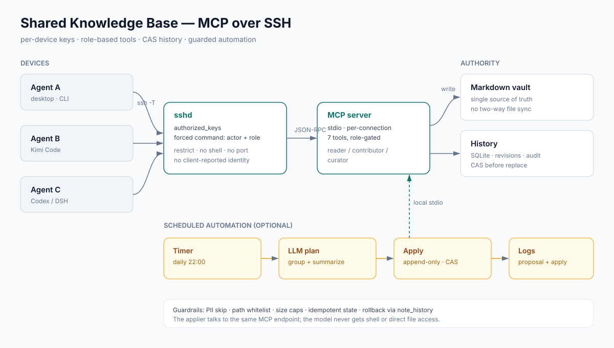

# Shared Knowledge Base over MCP

> A reference architecture for letting multiple AI agents on multiple devices share one Markdown knowledge base. The authority runs on a Linux host and is exposed through **MCP over SSH stdio** — no HTTP port, no resident service. Each device has its own Ed25519 key; the server binds identity and role to the key. Writes are protected by CAS and version history. Agents submit findings to an inbox; an optional scheduled job uses an LLM to propose and apply merges.

This repository shares the **framework only**. It contains no real hosts, accounts, keys, or business data.

[中文](README.md) · [Architecture diagram](docs/architecture.svg)

---

## 1. Goals

- **Single authority** — one Markdown tree, many devices and agents, no two-way file sync.
- **Identity cannot be self-reported** — who you are is decided by your SSH key, not by a string in the request.
- **Minimal surface** — no new ports, no HTTP service, no shell over the connection.
- **Auditable and reversible** — every write keeps the previous version; conflicts are rejected by CAS instead of overwritten.
- **Safe automation** — auto-merge only appends, with whitelists, caps and rollback.

## 2. Architecture



Key points:

- The client opens an SSH stdio connection; MCP JSON-RPC travels over stdin/stdout.
- Each `authorized_keys` entry carries a **forced command**:

  ```text
  restrict,command="/usr/local/bin/kb-entry <actor> <role>" ssh-ed25519 AAAA... <actor>
  ```

  `restrict` disables forwarding, PTY and X11; `command=` allows nothing but the MCP entry point.
- The server process starts with the actor/role encoded in the key, so a client cannot change them at request time.

## 3. Components

### 3.1 Authority

- A plain directory of Markdown files (openable in Obsidian).
- The server only lists, reads, searches and writes with versioning.
- No vector database, no resident service: one short-lived process per SSH connection.

### 3.2 Identity and roles

| Role | Capability |
|---|---|
| `reader` | list, search, read, history |
| `contributor` | reader + submit to its own inbox |
| `curator` | contributor + create/update shared notes (CAS required) |

- One key per device; several agents on one machine may share a key, and therefore an identity.
- Need per-tool isolation? Issue separate keys. Identity is a function of the key.
- Revocation = delete the line from `authorized_keys`; effective immediately.

### 3.3 Tools

Fixed, small surface — no shell, no delete, no rename:

```text
knowledge_status
list_notes
search_notes
read_note
note_history
read_revision
submit_note      # contributor and above
create_note      # curator
update_note      # curator, requires expected_revision
```

### 3.4 Consistency

- A write records a version first, then atomically replaces the file (temp file + `os.replace`).
- `update_note` must carry the SHA-256 revision read earlier; a mismatch returns a conflict and forces a re-read.
- Versions live in SQLite (path, revision, actor, reason, time, completion flag) for audit and rollback.
- A server-side content filter rejects private-key blocks, common tokens, webhooks and phone-number-like patterns.

### 3.5 Inbox workflow

Concurrent writes to the same note would overwrite each other, so contributors never edit shared notes directly:

1. An agent writes a self-contained record and calls `submit_note`, landing in `inbox/<actor>/<request_id>.md`.
2. The record states date, device, evidence, and whether each claim is verified, proposed, or decided by the user.
3. A curator merges records into project cards and daily notes by theme.
4. A registry records `path + revision read + destination`, which is how “not yet processed” is computed.

This turns write conflicts into merge latency: project cards are not real-time, but they are never silently clobbered.

### 3.6 Optional automation

A timer scans the inbox, asks a model for a merge plan, validates it, appends to target cards, and updates the registry. Guardrails:

- writes are limited to a `projects/` whitelist, path traversal rejected;
- existing cards are **appended to**, never rewritten;
- items matching PII/credential patterns are skipped and never sent to the model;
- per-run item and block-size caps;
- processed paths are persisted so a failed registry write cannot cause duplicate appends;
- every run leaves a proposal and an apply log; rollback through version history.

See [docs/automation.md](docs/automation.md).

## 4. One write, end to end

```text
Agent
  └─ ssh -T -i key knowledge-mcp@host
       └─ sshd verifies the key → runs the forced command (actor, role)
            └─ MCP server starts (stdio)
                 └─ tools/call update_note(path, content, expected_revision)
                      ├─ role check / content filter / size limits
                      ├─ read current file, compare revision
                      ├─ record version (SQLite)
                      ├─ atomically replace the file
                      └─ mark the version applied
```

## 5. Security model

- **No application port** — SSH only; MCP never listens on the network.
- **Key-derived identity** — server never trusts a client-supplied actor or role.
- **Forced command** — the connection cannot execute arbitrary commands.
- **Least privilege** — contributors write only to their own inbox; only curators touch shared cards.
- **No lost updates** — CAS plus history; there is no delete API.
- **Filtering** — credentials and phone-number-like patterns are rejected at write time.
- **Audit** — actor, reason and timestamp per write; `note_history` exposes them.

See [SECURITY.md](SECURITY.md) for the threat model and its limits.

## 6. Deployment checklist

1. Create a dedicated system user (e.g. `knowledge-mcp`) owning only the vault and program directories.
2. Put the vault somewhere that user can read/write; initialise an empty version DB.
3. Deploy the MCP server and an entry script (`kb-entry`) that validates arguments and `execve`s the server.
4. Generate a separate Ed25519 key on every device; hand only the `.pub` to the administrator.
5. Append one forced-command line per device to `~knowledge-mcp/.ssh/authorized_keys`.
6. Client configuration:

   ```toml
   [mcp_servers.knowledge]
   command = "/usr/bin/ssh"
   args = ["-T", "-o", "BatchMode=yes", "-o", "IdentitiesOnly=yes",
           "-o", "StrictHostKeyChecking=yes",
           "-i", "~/.ssh/kb_ed25519", "knowledge-mcp@knowledge.example.com"]
   ```

7. For scheduled merging, add a systemd timer and a root-only model credential file.

## 7. Operations

| Task | How |
|---|---|
| Check identity | `knowledge_status` |
| Revoke a device | remove its line from `authorized_keys` |
| Roll back a note | find the version with `note_history`, re-write as curator |
| Backup | vault directory + version SQLite |
| Automation logs | see the paths in your deployment |

## 8. Trade-offs and limits

- **Role per device**: every agent on a machine shares one role; per-tool isolation needs separate keys.
- **Renames fork history**: old records keep the old actor name.
- **Inbox latency**: contributor findings are not instantly visible on project cards.
- **Cloud model boundary**: automation sends inbox excerpts to a model; use a local model or disable it for sensitive data.
- **No deletion**: intentional; cleanup is an administrator action.

## 9. Layout

```text
.
├── README.md / README.en.md
├── SECURITY.md
├── docs/
│   ├── architecture.svg
│   └── automation.md
├── examples/
│   ├── kb_client.py
│   ├── consolidate_skeleton.py
│   └── authorized_keys.example
└── LICENSE
```

## License

MIT
