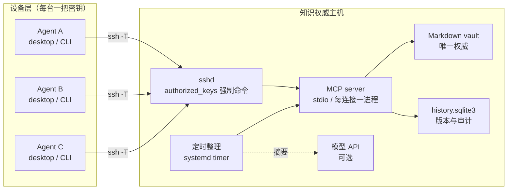

# 共享知识库 MCP 框架

> 一个「多设备 AI Agent 共用同一份 Markdown 知识库」的参考架构：知识权威部署在一台 Linux 主机上，通过 **SSH stdio** 暴露 MCP，不开放 HTTP 端口；每台设备一把 Ed25519 密钥，服务器按密钥绑定身份与角色；所有写入走 CAS 与版本历史；收件箱异步提交，可选的定时任务用模型生成整理提案并自动落卡。

本项目只分享**框架与设计**，不含任何真实部署的地址、账号、密钥或业务数据。

---

## 1. 设计目标

- **唯一权威**：一份 Markdown 库，多台设备、多个 Agent 读写同一处，不做双向文件同步。
- **身份不可自报**：客户端说“我是谁”不算数，身份由 SSH 公钥决定。
- **最小暴露面**：不新开端口、不跑 HTTP 服务、不暴露终端；SSH 连接只能触发 MCP。
- **可审计、可回滚**：每次写入保留旧版本，冲突用 CAS 拒绝而不是覆盖。
- **无人值守也安全**：自动整理只追加、不重写；有白名单、有上限、可回滚。

## 2. 总体架构



关键点：

- 客户端与服务器之间只有一条 SSH stdio 连接，MCP 的 JSON-RPC 走标准输入输出。
- `authorized_keys` 里每条公钥绑定一个**强制命令**，形如：

  ```text
  restrict,command="/usr/local/bin/kb-entry <actor> <role>" ssh-ed25519 AAAA... <actor>
  ```

  `restrict` 关闭端口转发、X11、PTY 等能力；`command=` 让这条连接只能启动 MCP，不能执行 shell。
- 服务端进程由连接的密钥参数启动，**角色在进程启动时固定**，客户端无法在请求里改。

## 3. 组件

### 3.1 知识权威

- 一个普通目录里的 Markdown 文件（Obsidian 可直接打开）。
- 服务端只做四件事：列目录、读文件、关键词检索、写文件（带版本）。
- 不依赖向量库、不依赖常驻服务；每次 SSH 连接起一个短进程。

### 3.2 身份与权限

| 角色 | 能力 |
|---|---|
| `reader` | 只读：列表、检索、读取、版本 |
| `contributor` | 只读 + 提交到自己的收件箱（不能改公共内容） |
| `curator` | contributor + 新建 / 更新公共卡（CAS 校验） |

- 一台设备一把密钥；同一台机器上的多个 Agent 可以共用一把密钥 → 一个身份。
- 需要“工具级隔离”时再拆密钥：身份是密钥的函数，不是客户端自报的字符串。
- 撤销 = 删掉 `authorized_keys` 里那一行，立即生效。

### 3.3 工具

只暴露固定几个工具，没有 shell、没有删除、没有重命名：

```text
knowledge_status
list_notes
search_notes
read_note
note_history
read_revision
submit_note        # contributor 及以上
create_note        # curator
update_note        # curator，必须带 expected_revision
```

### 3.4 存储与一致性

- 写入先落版本记录，再原子替换文件（临时文件 + `os.replace`）。
- `update_note` 必须提供读取时拿到的 SHA-256 revision；不匹配就返回冲突，要求重读合并。
- 版本历史进 SQLite（路径、revision、actor、原因、时间、是否完成），用于审计与回滚。
- 服务端还有一层内容过滤：私钥块、常见 token、webhook、手机号等模式会拒绝写入。

### 3.5 收件箱工作流

多设备并发写同一张卡会互相覆盖，所以默认不让 contributor 直接改公共卡：

1. Agent 把结论写成一条独立记录，`submit_note` 到 `inbox/<actor>/<request_id>.md`；
2. 记录里注明日期、设备、证据，以及「已验证 / 建议 / 用户已拍板」；
3. curator 按主题把收件箱归并进项目卡与日记；
4. 处理登记表记录「路径 + 读到时的 revision + 落点」，用于判断哪些还没处理。

这套流程把“写冲突”降级成“整理延迟”，代价是公共卡不是实时的。

### 3.6 自动整理（可选）

定时任务扫收件箱 → 调模型生成归并方案 → 校验 → 追加到目标卡 → 更新登记。安全约束：

- 只允许写 `projects/` 白名单目录，拒绝路径穿越；
- 已有卡**只追加**一个小节，不重写历史内容；
- 命中个人信息/凭据模式的条目跳过，不送模型；
- 每批条数、单块长度都有上限；
- 已处理路径写入状态文件，登记失败也不会重复追加；
- 每次运行写日志，出问题按版本历史回滚。

细节见 [docs/automation.md](docs/automation.md)。

## 4. 一次写入的完整链路

```text
Agent
  └─ ssh -T -i key knowledge-mcp@host
       └─ sshd 校验公钥 → 执行强制命令（actor, role）
            └─ MCP server 启动（stdio）
                 └─ tools/call update_note(path, content, expected_revision)
                      ├─ 校验角色 / 内容过滤 / 大小限制
                      ├─ 读取当前文件，比较 revision
                      ├─ 写版本记录（SQLite）
                      ├─ 原子替换文件
                      └─ 标记版本完成
```

## 5. 安全模型

- **没有应用端口**：只有 SSH；MCP 不出现在网络上。
- **身份由密钥决定**：服务端不信任客户端自报的 actor/role。
- **强制命令**：连接不能执行任意命令，只能进 MCP。
- **最小权限**：contributor 只能写自己的收件箱；curator 才能改公共卡。
- **防覆盖**：CAS + 版本历史；没有删除接口。
- **内容过滤**：写入口拦截私钥、token、webhook、手机号等模式。
- **审计**：每次写入记录 actor、原因、时间；`note_history` 可查。

更完整的威胁模型见 [SECURITY.md](SECURITY.md)。

## 6. 部署清单

1. 建一个专用系统用户（如 `knowledge-mcp`），只给它库目录与程序目录的权限。
2. 把 vault 放在该用户可读写的目录，初始化空的版本库。
3. 部署 MCP 服务端程序与入口脚本（`kb-entry`），入口脚本校验参数后 `execve` 到服务端。
4. 每台设备生成独立 Ed25519 密钥，只把 `.pub` 交给管理员。
5. 管理员在 `~knowledge-mcp/.ssh/authorized_keys` 追加带强制命令的一行，角色按需给。
6. 客户端配置示例：

   ```toml
   [mcp_servers.knowledge]
   command = "/usr/bin/ssh"
   args = ["-T", "-o", "BatchMode=yes", "-o", "IdentitiesOnly=yes",
           "-o", "StrictHostKeyChecking=yes",
           "-i", "~/.ssh/kb_ed25519", "knowledge-mcp@knowledge.example.com"]
   ```

7. 需要定时整理时，再加 systemd timer 与模型凭据（root-only 文件）。

## 7. 运维

| 操作 | 命令/位置 |
|---|---|
| 查看身份 | `knowledge_status` |
| 撤销设备 | 从 `authorized_keys` 删除对应行 |
| 回滚笔记 | `note_history` 找版本，curator 重新写入 |
| 备份 | 备份 vault 目录 + 版本 SQLite |
| 自动任务日志 | 见部署时的日志路径 |

## 8. 取舍与已知限制

- **按设备分权**：同一台机器的所有 Agent 共享角色；要工具级隔离必须拆密钥。
- **改名会分叉历史**：actor 改名后，旧记录仍用旧名。
- **收件箱有延迟**：contributor 的结论不会立刻出现在公共卡上。
- **云端模型的数据边界**：自动整理会把收件箱摘要发给模型；涉密场景应换本地模型或关闭。
- **没有删除**：这是刻意设计，清理需要管理员在服务器上操作。

## 9. 目录

```text
.
├── README.md
├── SECURITY.md
├── docs/
│   └── automation.md
├── examples/
│   ├── kb_client.py            # 最小 MCP 客户端（SSH stdio）
│   ├── consolidate_skeleton.py # 自动整理骨架
│   └── authorized_keys.example
└── LICENSE
```

## License

MIT
